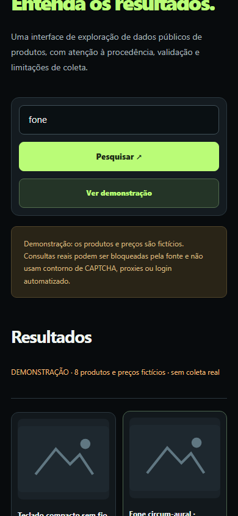

# Product Discovery Lab

Aplicação web para **pesquisar e explorar informações públicas de produtos da Amazon**, com API em Node.js e uma interface responsiva.

  

## Interface

| Desktop | Celular |
| --- | --- |
|  |  |

## Funcionalidades

- **Pesquisa por palavra-chave:** consulte as listagens públicas de produtos disponíveis.
- **Cartões de produto:** título, imagem, preço, avaliação e link para a página original, quando presentes.
- **Paginação:** navegue pelas primeiras páginas retornadas pela pesquisa.
- **Modo demonstração:** conheça a interface sem depender de uma consulta externa.
- **Feedback de busca:** visualize estados de carregamento, resultados vazios e mensagens de erro.
- **Layout responsivo:** experiência adaptada para computador e celular.

Os produtos e preços da **demonstração são fictícios**, identificados na própria interface. A busca real depende da disponibilidade do site de origem.

## Como executar

**Requisito:** Node.js 20.19 ou superior, com npm.

```bash
git clone https://github.com/JackNoArms/amazon-scraper.git
cd amazon-scraper
npm ci
npm start
```

Acesse **http://127.0.0.1:3000** no navegador.

O mesmo servidor disponibiliza a interface e a API. O catálogo de demonstração aparece automaticamente ao abrir a aplicação. Para pesquisar, informe um termo e clique em **Pesquisar**.

## API

```http
GET /api/health
GET /api/scrape?keyword=teclado&page=1
```

A pesquisa retorna um objeto com `products`, `page`, `count` e `source`. Os produtos incluem os campos disponíveis entre `title`, `price`, `rating`, `reviewCount`, `imageUrl`, `url` e `prime`.

A aplicação limita as consultas a páginas públicas e não tenta contornar autenticação, CAPTCHA ou bloqueios do provedor.

## Tecnologias

| Tecnologia | Responsabilidade |
| --- | --- |
| **Node.js e Express** | Servidor web e endpoints HTTP |
| **Axios** | Requisições às páginas públicas |
| **JSDOM** | Leitura e extração de informações do HTML |
| **JavaScript (ES Modules)** | Interface e componentes interativos |
| **CSS** | Layout responsivo e apresentação dos resultados |
| **Node Test Runner** | Testes automatizados |

## Organização

```text
backend/
  src/domain/          Casos de uso
  src/infrastructure/  Cliente HTTP, controle de frequência e parser
  src/presentation/    Controllers e rotas da API
frontend/
  index.html           Página principal
  src/                 Componentes, busca e estilos
tests/                 Testes automatizados
docs/                  Capturas da interface
```

## Testes e distribuição

```bash
npm test
npm run build:ui
```

O comando `build:ui` gera uma cópia estática da interface em `dist/`. A aplicação completa, incluindo buscas, deve ser executada com `npm start`.

*Projeto independente para fins de estudo; não afiliado à Amazon.*
