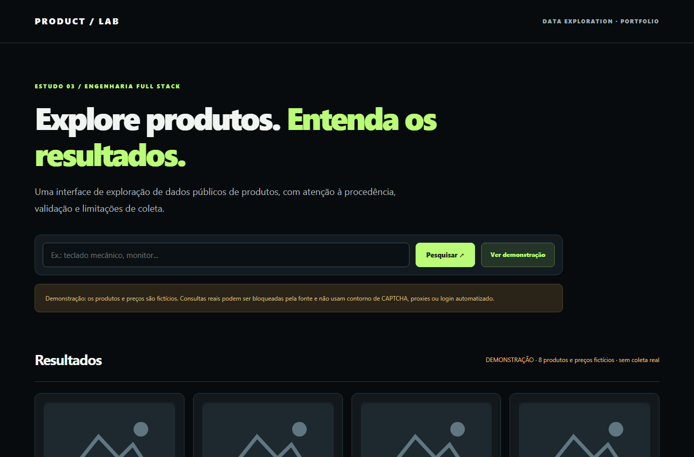

# Product Discovery Lab

**Aplicação full-stack para pesquisar e visualizar informações públicas de produtos da Amazon.** Combina uma API Node.js com um frontend responsivo em JavaScript.

  

## Interface

| Desktop | Celular |
| --- | --- |
|  |  |

## Funcionalidades

- **Pesquisa por palavra-chave:** informe o produto desejado para buscar listagens públicas.
- **Resultados em cartões:** nome, preço disponível, avaliação, imagem e link para a página original.
- **Paginação:** navegue pelas primeiras páginas de resultados disponíveis.
- **Modo demonstração:** explore a interface mesmo quando a consulta ao site não estiver disponível.
- **Tratamento de falhas:** mensagens claras quando não há resultados, quando a API está indisponível ou quando a fonte restringe a consulta.
- **Design responsivo:** interface adaptada para desktop e celular, com navegação por teclado.

O modo demonstração utiliza **produtos e preços fictícios**, identificados na tela. As consultas reais dependem da disponibilidade das páginas públicas da Amazon.

## Tecnologias

| Tecnologia | Utilização |
| --- | --- |
| **Node.js e Express** | Servidor HTTP e endpoints de consulta |
| **Axios** | Solicitações HTTP às páginas públicas |
| **JSDOM** | Extração dos campos de produto a partir do HTML |
| **JavaScript e Vite** | Frontend e compilação |
| **CSS** | Layout e componentes responsivos |
| **Node Test Runner** | Testes automatizados |

## Como executar

**Pré-requisitos:** Node.js 20 ou superior e npm.

```bash
git clone https://github.com/JackNoArms/amazon-scraper.git
cd amazon-scraper
npm ci
npm --prefix frontend ci
```

Abra dois terminais na pasta raiz do projeto.

**Terminal 1 — API local:**

```bash
npm run dev:api
```

**Terminal 2 — interface:**

```bash
npm run dev:ui
```

A interface será disponibilizada pelo Vite, normalmente em **http://localhost:5173**, e a API utiliza **http://127.0.0.1:3000**.

A demonstração funciona sem o backend. Para pesquisar listagens reais, deixe ambos os processos iniciados.

## API

```http
GET /api/health
GET /api/scrape?keyword=teclado&page=1
```

Uma busca bem-sucedida retorna um objeto com `products`, `page`, `count` e `source`. Cada produto pode incluir `title`, `price`, `rating`, `reviewCount`, `imageUrl`, `url` e `prime`.

As páginas disponíveis e os campos extraídos dependem da estrutura atual da fonte.

## Estrutura

```text
backend/
  src/domain/           Casos de uso
  src/infrastructure/   HTTP, limite de consultas e parser HTML
  src/presentation/     Controller e rotas
frontend/
  src/components/       Formulário e cartões de produto
  src/core/api/         Cliente da API
  src/pages/            Página de pesquisa
  src/styles/           Estilos da interface
tests/                  Testes da API, parser e frontend
docs/                   Capturas da interface
```

## Testes

```bash
npm test
npm run build:ui
```

O backend utiliza consultas com tempo limite e controle de frequência. O projeto **não tenta contornar CAPTCHA, autenticação ou bloqueios do provedor**. Caso a coleta automatizada seja restrita, utilize a demonstração para conhecer a interface.

*Projeto independente para fins de estudo. Não afiliado à Amazon.*
